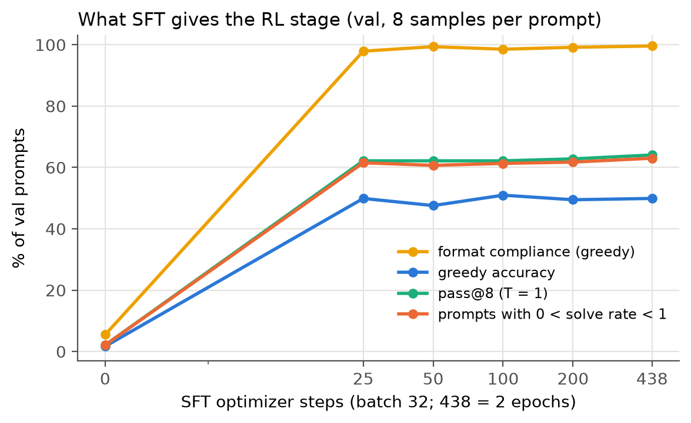
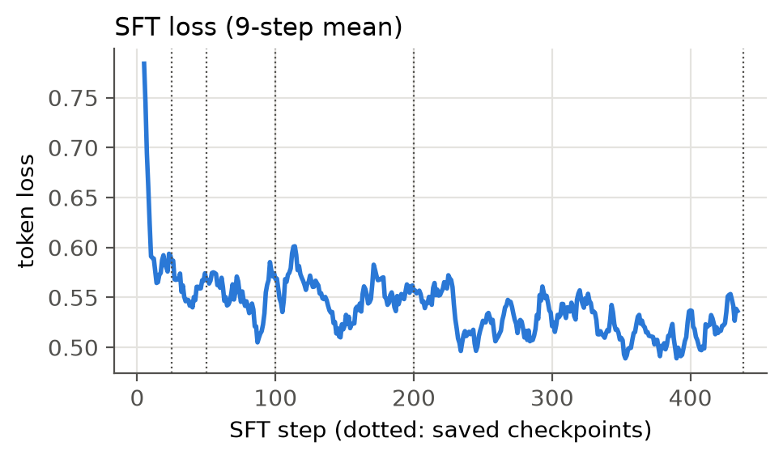
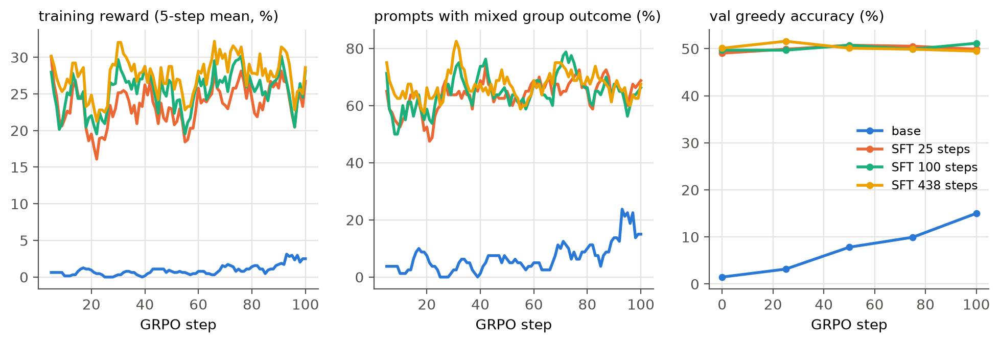
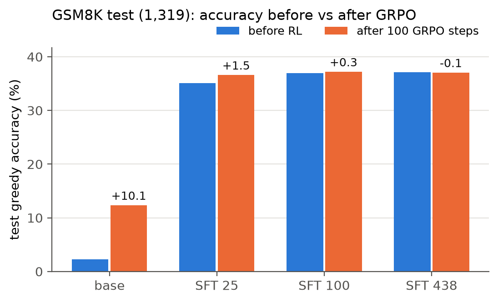
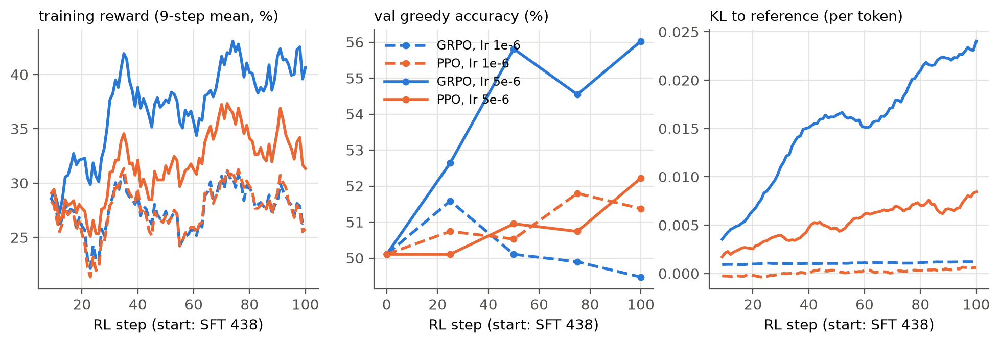
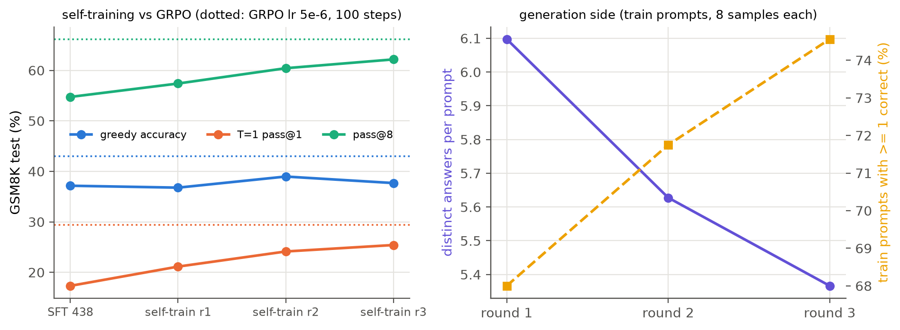

# SFT 到哪裡該交給 RL？Qwen2.5-0.5B 在 GSM8K 上的 SFT → GRPO / PPO 實驗

- **模型**：Qwen2.5-0.5B **base**（不是 Instruct 版）。
- **資料**：GSM8K。
- **訓練方式**：全參數微調（不用 LoRA）。PPO 和 GRPO 都在 PyTorch 上自己實作，生成交給同一張 GPU 上的 vLLM，每個 RL step 結束後把 policy 權重同步給 vLLM。
- **硬體與軟體**：RTX 3060 12 GB，torch 2.7.1、vLLM 0.10.1.1、transformers 4.56。
- **延伸自**：「生成式 AI 與機器學習導論 2025」HW07。HW07 的 RL 階段是 DPO，屬於 offline 偏好最佳化，沒有 PPO/GRPO 這類 online RL。所以這個專案把 RL 換成 PPO/GRPO，並把模型換成小一號的版本，才放得進 12 GB。

## 0. 規則

| split | 題數 | 來源 | 用途 |
|---|---|---|---|
| train | 7,000 | GSM8K train | SFT 資料、RL 的 prompts |
| val | 473 | GSM8K train，以 seed 0 抽出 | 訓練中的監控 |
| test | 1,319 | GSM8K test | 主要報告的數字 |

- **Reward**：模型輸出中 `#### <數字>` 的數字和正確答案相同得 1 分，否則 0 分。格式不對也是 0 分。
- **Prompt**：`Question: …\nAnswer: Let's think step by step.\n`
- **評估指標**：greedy accuracy；在 T = 1 下每題抽 8 個樣本，算 pass@1、pass@8，以及「8 個樣本有對有錯」的題目比例。
- **事先登記**：先固定實驗設計再跑，避免看到結果後才挑選。內容是 SFT checkpoint 0 / 25 / 50 / 100 / 200 / 438 步全部評估；從 base、SFT 25、SFT 100、SFT 438 各接一次 GRPO（各 100 步，lr 1e-6）；從 SFT 438 接一次 PPO（同樣設定）。
- **事後追加**（第 4 節）：上面的設定 policy 幾乎沒動，所以另外用 lr 5e-6 重跑 GRPO 和 PPO 各一次。這是看到結果後才加的，報告中分開標示。
- **val 可能被污染**：val 的 greedy accuracy 一直比 test 高 13–15 pt。val 是從 GSM8K train 切出來的，最可能的原因是 Qwen2.5 預訓練時看過 GSM8K train 的題目，所以**結論一律以 test 為準**。
- 每個 RL 設定都只跑 **1 個 seed**。test 有 1,319 題，單一準確率的標準誤約 ±1.3 pt，所以 2.6 pt 以內的差距一律視為雜訊。

## 1. SFT 給了 RL 什麼




| 起點 | test greedy | 格式正確率 | T = 1 pass@1 | pass@8 | 有對有錯的題目比例 | 8 個全錯的比例 |
|---|---|---|---|---|---|---|
| base | 2.3 | 5.9 | 0.3 | 2.0 | **2.0** | 98.0 |
| SFT 25 步（800 筆） | 35.1 | 98.0 | 14.6 | 48.9 | 48.8 | 51.1 |
| SFT 50 步 | 35.0 | 97.3 | 16.3 | 52.2 | 51.8 | 47.8 |
| SFT 100 步 | 36.9 | 97.9 | 16.0 | 50.4 | 50.0 | 49.6 |
| SFT 200 步 | 36.8 | 97.4 | 16.2 | 51.9 | 51.6 | 48.1 |
| SFT 438 步（2 epochs） | 37.1 | 97.6 | 17.3 | 54.7 | 54.6 | 45.3 |

- base model 其實常常算對（例如第一題算出 5 hours，第二題算出 62），**只是不會用 `####` 寫出答案**。所以它 98% 的題目 8 個樣本全錯；對 GRPO 來說，這些題目的 advantage 全部是 0，沒有任何梯度。
- **只要 25 步 SFT（800 筆資料）**，格式正確率就從 5.9% 升到 98%，有對有錯的題目也從 2% 升到 49%。
- 之後再多做 17 倍的 SFT（到 438 步），greedy accuracy 只多 2 pt，pass@8 多 6 pt。**SFT 在這個任務上的主要貢獻是教格式**，第 25 步之後就接近飽和。
- T = 1 的 pass@1（約 16%）和 pass@8（約 52%）之間有約 35 pt 的差距：模型常常「抽得到」正確答案，但不穩定。這段差距就是 RL 可以發揮的空間。

## 2. 從不同起點做 GRPO（事先登記，lr 1e-6，100 步）




| 起點 | RL 前 test greedy | RL 後 test greedy | 變化 | 訓練中平均有對有錯的比例 |
|---|---|---|---|---|
| base | 2.3 | 12.4 | +10.1 | 7% |
| SFT 25 | 35.1 | 36.6 | +1.5 | 約 65% |
| SFT 100 | 36.9 | 37.2 | +0.3 | 約 65% |
| SFT 438 | 37.1 | 37.1 | 0.0 | 67% |

- **從 base 直接做 RL**：一開始幾乎每個 step 的 128 個樣本全拿 0 分。100 步之後格式正確率只到 31%，test 只有 12.4%，還不到 25 步 SFT（35.1%）的一半。小模型如果沒有 SFT 先教格式，RL 幾乎拿不到學習訊號。
- **從 SFT checkpoint 出發**：lr 1e-6、100 步時，三個起點的變化都在 ±1.5 pt 以內，也就是雜訊範圍。KL 一直維持在約 0.001，代表 policy 幾乎沒有離開 reference model。限制它的是**學習率和步數**，不是 SFT 起點。

## 3. PPO 對 GRPO（事先登記，SFT 438 出發，lr 1e-6）

兩者的條件刻意對齊：每步 16 題 × 8 個樣本，每次 rollout 做 4 次 optimizer step，clip 0.2，β = 0.04。

| | test greedy | T = 1 pass@1 | pass@8 | 每步秒數 | 峰值顯存 |
|---|---|---|---|---|---|
| GRPO | 37.1 | 18.5 | 55.3 | 24.5 | 9.0 GB |
| PPO | 36.6 | 18.5 | 55.0 | 31.2 | 10.3 GB |

lr 1e-6 時兩者都幾乎沒有變化，準確率比不出差別；看得出差別的只有成本：PPO 每步慢 27%，顯存多 1.3 GB。

## 4. 事後追加：lr 5e-6（SFT 438 出發，100 步）



| | val greedy | test greedy | T = 1 pass@1 | pass@8 | 8 個全錯的比例 | KL（最後一步） | 每步秒數 | 峰值顯存 |
|---|---|---|---|---|---|---|---|---|
| SFT 438（RL 前） | 49.9 | 37.1 | 17.3 | 54.7 | 45.3 | — | — | — |
| **GRPO** | **56.0** | **43.0** | **29.4** | **66.2** | 33.8 | 0.026 | 23.4 | 8.8 GB |
| PPO | 51.6 | 36.9 | 24.0 | 61.6 | 38.4 | 0.008 | 30.9 | 10.4 GB |

- **GRPO 讓 test greedy 提高 5.9 pt，T = 1 pass@1 提高 12.1 pt。** 這個實驗只有一個 seed，差距大約是標準誤的 3 倍。
- pass@8 也提高 11.5 pt，8 個全錯的題目從 45.3% 降到 33.8%。所以在 k = 8 這個範圍，RL 不只是讓已經會的題目更穩定，也讓一些原本 8 次都抽不到正確答案的題目開始抽得到。Yue et al. (2025) 說「RL 只是集中機率」，比的是 k 很大（例如 256）時的 pass@k，這裡沒有測，所以兩者不衝突。
- **PPO 在同一個學習率下**，T = 1 pass@1 有提高（+6.7），但 greedy accuracy 沒有變，KL 也只有 GRPO 的三分之一。可能的原因：critic 的 value head 從 0 初始化，而且為了省顯存只訓練最上面 6 層，前面幾十步的 advantage 主要是 critic 尚未學好的雜訊。這次沒有用 critic warm-up 或更高的 critic lr 來驗證這個推測，所以**不能說 PPO 本質上比較差**，只能說在相同取樣預算和這個 critic 設定下，GRPO 比較省，也進步得比較快。

## 5. 結論：SFT 到哪裡該交給 RL

1. **看格式正確率，不要看 SFT 做了幾個 epoch。** 格式正確率一旦接近 100%，SFT 能帶來的進步就很有限（這裡 25 步就飽和）。
2. **看「有對有錯」的題目比例。** 這個比例很低時（base 只有 2%），GRPO 拿不到梯度；SFT 把它拉到 50% 左右之後，RL 才有東西可學。這個指標只要對每題抽 8 個樣本就能算，成本很低，適合拿來判斷要不要切換到 RL。
3. **RL 能改進的空間大約就是 pass@k 和 pass@1 之間的差距。** 這次 GRPO 縮小了這段差距（T = 1 pass@1 從 17% 到 29%）。
4. **學習率很關鍵。** 文獻常用的 lr 1e-6，在 100 步的預算下幾乎不會動；5e-6 才有明顯效果。這次預算有限，沒有做完整的 LR sweep。
5. **GRPO 比 PPO 省**：同樣的取樣量下，PPO 每步慢約 30%、顯存多 1.3–1.6 GB，因為它多了一個 critic。

## 6. 事後追加：self-training（ReST-EM 式 expert iteration，3 輪）

在第 4 節之後才加的實驗，但設計在跑之前就固定（見 `pt/selftrain.py` 開頭）。

- **起點**：SFT 438，和 GRPO / PPO 相同。
- **每輪**：用上一輪的模型對 1,600 題新的 train 題目各取樣 8 次（T = 1）。12,800 個樣本，等於 GRPO 100 步的取樣量；三輪題目互不重疊。
- **篩選**：只留 `####` 答案正確的解答，去掉完全重複的，每題最多 4 個。
- **訓練**：每輪都**從 SFT 438 重新微調**（ReST-EM），配方和原本的 SFT 相同（lr 1e-5、batch 32、2 epochs）。



| GSM8K test (%) | greedy | T=1 pass@1 | pass@8 | 全錯題比例 |
|---|---|---|---|---|
| SFT 438（起點） | 37.1 | 17.3 | 54.7 | 45.3 |
| self-training 第 1 輪 | 36.8 | 21.1 | 57.4 | 42.6 |
| self-training 第 2 輪 | 39.0 | 24.1 | 60.4 | 39.6 |
| self-training 第 3 輪 | 37.7 | 25.4 | 62.2 | 37.8 |
| GRPO lr 5e-6，100 步 | **43.0** | **29.4** | **66.2** | **33.8** |

| 生成端（train 題目） | 第 1 輪 | 第 2 輪 | 第 3 輪 |
|---|---|---|---|
| 樣本正確率 | 26.2% | 31.2% | 34.6% |
| 至少答對一次的題目 | 68.0% | 71.8% | 74.6% |
| 留下的訓練樣本 | 2,856 | 3,209 | 3,447 |
| 8 個樣本中不同答案數（平均） | 6.10 | 5.63 | 5.37 |
| 8 個樣本中不同文字數（平均） | 8.00 | 8.00 | 8.00 |
| 生成 + 訓練時間 | 279 + 315 s | 296 + 354 s | 271 + 365 s |

**觀察**

1. **同樣取樣量下 GRPO 比較有效。** 第 1 輪和 GRPO 100 步都用 12,800 個樣本，greedy 36.8% 對 43.0%，T=1 pass@1 21.1% 對 29.4%。三輪加起來用了 3 倍樣本，所有指標仍然低於 GRPO。
2. **self-training 改善的是取樣，不是 greedy。** T=1 pass@1 每輪都升（17.3 → 25.4%），greedy 卻一直在 36.8–39.0% 之間。test 有 1,319 題，標準誤約 1.3 pt，這個起伏看不出趨勢。我的解讀是：只用答對的樣本做 SFT，會把分布中「本來就答得出來」的部分加重，但最可能的那條路徑（greedy）不太會變。GRPO 同時有答錯樣本的負訊號，這一點 self-training 沒有。
3. **3 輪內沒有看到 collapse。** 不同答案數從 6.10 降到 5.37，但同時答對的比例也在升，答對的樣本本來就會收斂到同一個答案，所以這個下降不能直接解讀成多樣性變差。文字層面 8 個樣本幾乎都不同，test pass@8 也一路升到 62.2%。如果有 collapse，pass@8 應該會先停或下降。
4. **成本低。** 一輪（生成 + 訓練）約 10 分鐘；GRPO 100 步是 23.4 s × 100 ≈ 39 分鐘。不過以同樣時間跑 3 輪，結果仍不如 GRPO。

## 限制

- 只有一個模型、一個任務（GSM8K），每個 RL 設定只跑一個 seed，每次 100 步。
- val 疑似被預訓練資料污染，所以只看 test。
- PPO 的 critic 為了省顯存只訓練上面 6 層，而且從 0 初始化，對 PPO 不利。
- lr 5e-6 的實驗是看到結果後才追加的，不在事先登記的設計裡。
- self-training 也是事後追加，只跑一個 seed，lr（1e-5）沿用 SFT 配方，和 GRPO 的 5e-6 不同；沒有試更多輪或其他篩選方式。

## 重現

```bash
cd ~/llm-posttrain && uv sync
uv run python -m pt.data                 # GSM8K splits
uv run python -m pt.evaluate Qwen/Qwen2.5-0.5B runs/eval_base.json
uv run python -m pt.sft                  # 存 25/50/100/200/438 步的 checkpoint
./scripts/run_all.sh                     # 事先登記的評估、GRPO ×4、PPO
uv run python -m pt.rl grpo ckpt/sft_0438 grpo_from_sft0438_lr5e-6 100 5e-6   # 事後追加
uv run python -m pt.rl ppo  ckpt/sft_0438 ppo_from_sft0438_lr5e-6 100 5e-6
./scripts/selftrain.sh                   # self-training 3 輪（生成 → 訓練 → 評估）
uv run python scripts/make_figs.py
```
